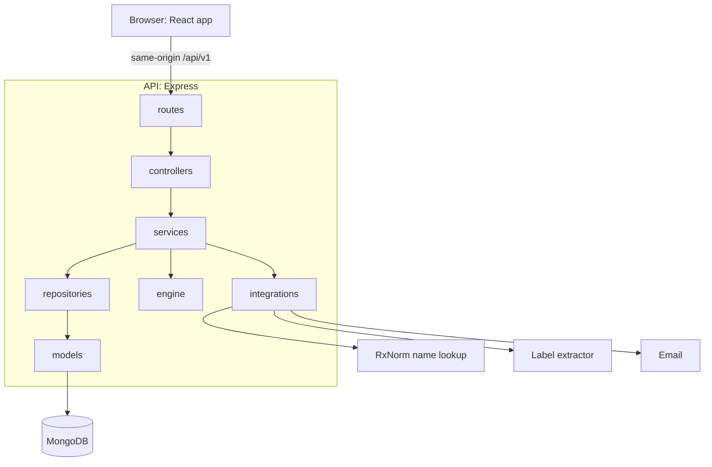
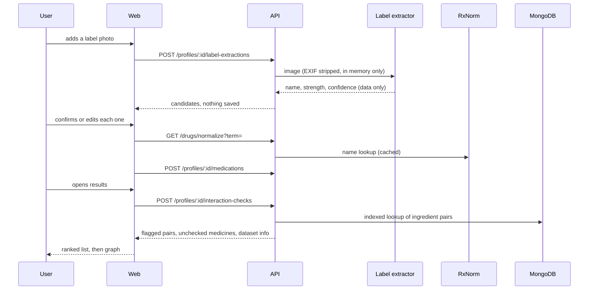

# Architecture

## Overview

## Backend layers

| Layer        | Folder          | May import                         | Job                                        |
| ------------ | --------------- | ---------------------------------- | ------------------------------------------ |
| Routes       | `routes/`       | controllers, middleware            | Declarative route table, nothing else      |
| Controllers  | `controllers/`  | services, dto                      | Call one service method, map to a DTO      |
| Services     | `services/`     | repositories, integrations, engine | All business rules and authorisation       |
| Repositories | `repositories/` | models                             | All database access, returns plain objects |
| Models       | `models/`       | types                              | Mongoose schemas and indexes               |
| Engine       | `engine/`       | types                              | Pure interaction logic                     |
| Integrations | `integrations/` | utils, config                      | Ports and adapters for outside services    |

`utils/`, `config/` and `types/` are shared helpers below every layer. The composition root
(`app.ts`, `server.ts`, `container.ts`) wires everything. ESLint (`eslint-plugin-boundaries`)
fails the build when an import breaks these rules, and only repositories and models may
import Mongoose.

### One route, end to end

A route is a `RouteSpec` object: method, path, zod schemas for params, query and body, the
response schema per status, and flags (`ifMatch`, `idempotent`, `csrf`, `rateLimit`).
`routes/build-router.ts` turns the table into Express handlers that authenticate, validate,
call the controller and serialise the result through the response schema. The same table
produces `docs/openapi.json`.

## Frontend layers

| Layer        | Folder          | May import          | Job                                         |
| ------------ | --------------- | ------------------- | ------------------------------------------- |
| Presentation | `presentation/` | application, domain | Pages and components. No fetching, no rules |
| Application  | `application/`  | services, domain    | Hooks, queries, forms, UI state, animation  |
| Services     | `services/`     | domain              | Typed API client. No React                  |
| Domain       | `domain/`       | shared package      | Types, constants, pure functions            |

`app/` holds routing, providers and bootstrap and may import every layer.

## Data flow for a check

